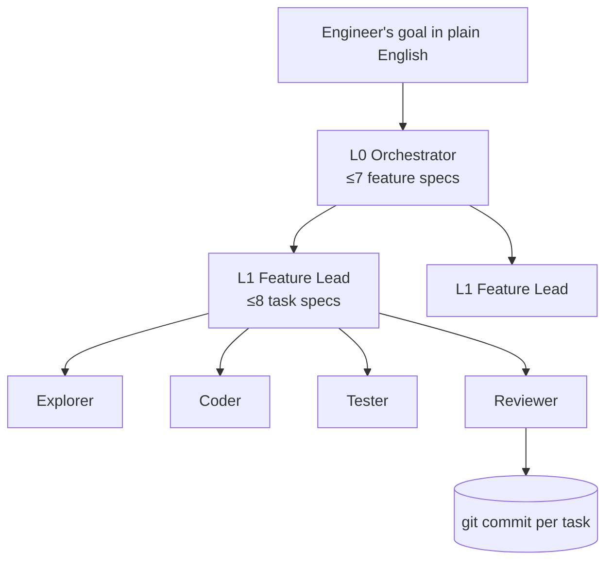
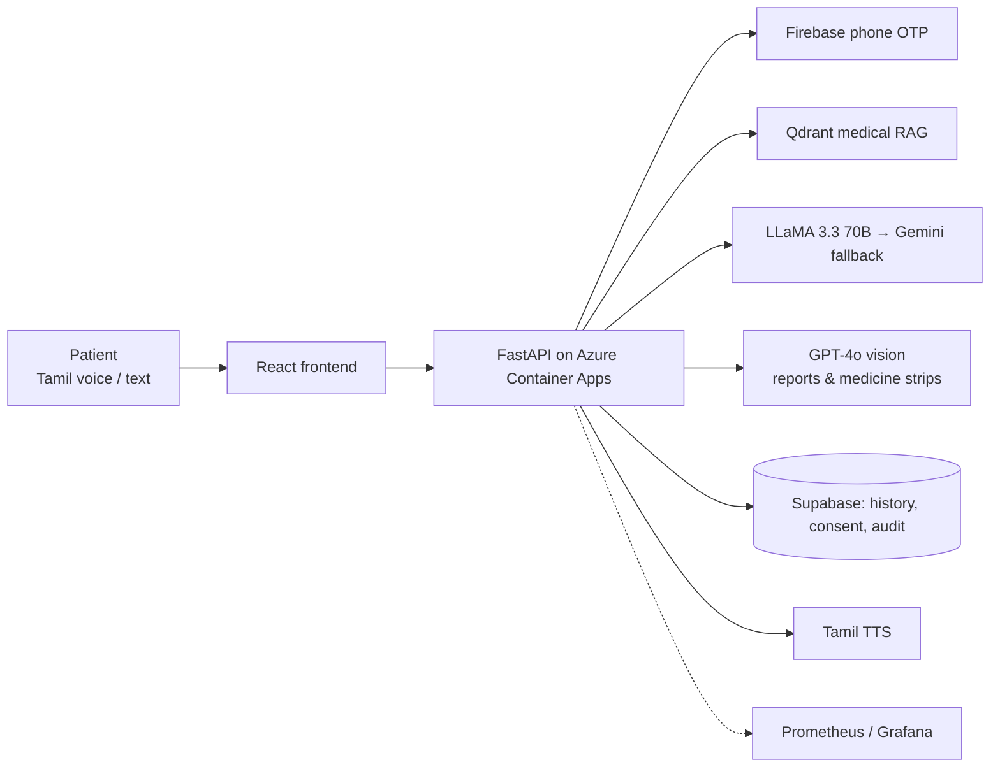
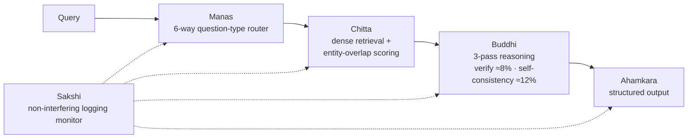

# 👋 Hi, I'm Rajaganapathy M

### GenAI & Agentic AI Architect · LLM / ML Engineer · Computer Vision . AI Security

I design and ship **production AI systems**: multi-agent platforms, RAG pipelines, fine-tuned LLMs and vision-language models, deployed on Azure / AWS / GCP, and I build them security-aware.

📄 **Indian Patent Filed** · 📚 **IEEE Xplore Published** · 🎓 **M.Tech AI (PG) completed, SRM (CGPA 9.6/10)** · 🚀 **Live AI product + active startup build** · 🛡 **Cyber-security labs on GitHub** · 🛠 **9+ yrs safety-critical engineering before AI**

📍 Chennai, India · open to **Bangalore · Hyderabad · Remote** · ⚡ **Immediate joiner**

---

## 🎯 What I'm looking for

| Role | What I bring |
|---|---|
| **GenAI / AI Architect** | End-to-end design: RAG, LLM routing, evaluation, cloud deployment, IaC, compliance |
| **Agentic AI Architect / Engineer** | Hierarchical multi-agent systems (Google ADK), tool calling, memory, LLM-as-Judge evals |
| **GenAI / LLM Developer** | Fine-tuning (LoRA/QLoRA), RAG with Qdrant/FAISS, FastAPI services, production LLM apps |
| **ML / Computer Vision Engineer** | PyTorch, CLIP, BLIP, ViT, OpenCV; classical ML with XGBoost / scikit-learn |
| **AI Security / DevSecOps (AI-focused)** | Hands-on labs in DevSecOps on Azure, DFIR, SOC monitoring (Wazuh), web/API testing and AI/LLM security |
| **Research Engineer** | Patent filing + IEEE Xplore paper with benchmarked results |

---

## 🏗 Featured Work

### 🤖 Spec-Driven Multi-Agent Coding System *(active, startup client)*
A 3-level agent hierarchy that turns a plain-English goal into tested, reviewed, committed code.
**Google ADK · Gemini 2.5 Flash · Multi-Agent · LLM-as-Judge · Git automation**

- Versioned markdown specs as the contract between agents
- Path-sandboxed file tools, YAML-configurable models / tools / retries
- Golden-task evaluation + LLM-as-Judge scoring, live status board with full traces
- Delivered a HIPAA-oriented healthcare QA system (JWT auth, audit logging, PHI/PII protection)

---

### 🏥 [Anbu Health AI](https://anbuclinic.me) *(live in production)*
Multilingual (Tamil/English) AI health assistant used by real patients at a village clinic, with voice input, OTP login and medical report/prescription analysis. Delivered as a paid engagement under AI Vision.

**FastAPI · React · Groq LLaMA 3.3 70B + Gemini fallback · GPT-4o vision · Qdrant RAG · Supabase · Azure Container Apps · Terraform · GitHub Actions · Prometheus/Grafana**

DPDP Act 2023 compliance · consent management · PHI redaction · right to erasure · Schedule H1 drug-safety blocking.

---

### 🧠 [Antahkarana Reasoning Framework](https://github.com/rajaganaa/antahkarana-reasoning-framework) 🥇
*Patent filed (App. No. 202641043947) · [IEEE Xplore, ICSTSDG 2026](https://ieeexplore.ieee.org/document/11708384)*
*2026 2nd International Conference on Smart Technologies for Sustainable Development Goals, Chennai · 19–21 Aug 2026 · added to IEEE Xplore 06 Oct 2026 · DOI [10.1109/ICSTSDG69220.2026.11708384](https://doi.org/10.1109/ICSTSDG69220.2026.11708384)*

Monolithic prompting spends the same compute on every query. Antahkarana is a five-module cognitive architecture for LLMs and VLMs that **routes by question type and only triggers verification / self-consistency passes when needed**.

| Result (Qwen2.5-7B / BLIP-2 Flan-T5-XL) | Outcome |
|---|---|
| TruthfulQA accuracy vs direct prompting | **+59.61%** |
| SVAMP exact match | **+40.06%** |
| FEVER F1 vs CoT | **+250.82%** |
| Model calls vs uniform Self-Consistency (VQA) | **26% fewer** (2,219 vs 3,000) |
| VQA hallucination | **26.6% → 20.9%** (79.1% exact match) |

On HotpotQA and MMLU it performs comparably to, or below, Self-Consistency, an intentional precision-vs-overcall calibration documented in the paper.
[Live demo](https://rajaganaa.github.io/antahkarana-frontend/)

---

### 🛡 [AI-Augmented Cyber-Security Portfolio](https://github.com/rajaganaa/ai_cyber_security)
Five hands-on security-engineering labs built to demonstrate practical blue-team and security-engineering skills.

| Lab | Focus |
|---|---|
| `devsecops-azure-lab` | DevSecOps on Azure |
| `dfir-investigation-lab` | Digital forensics & incident response |
| `mini-soc-lab` | SOC monitoring |
| `web-api-security-assessment` | Web / API penetration-testing assessment |
| `ai-security-lab` | AI / LLM security |

**Python · Azure + Terraform · Docker Compose · GitHub Actions CI/CD · Wazuh SIEM/XDR · Ollama (local LLM) · MIT**

---

### More projects

| Project | Highlights |
|---|---|
| [**AgentNet Enterprise Support**](https://github.com/rajaganaa/AgentNet-Enterprise-Support) | Triage → Response → **LLM-as-Judge** self-grading loop with vector memory (LangChain, FAISS, Vertex AI) |
| [**Antahkarana Medical AI**](https://github.com/rajaganaa/antahkarana-product) | Multimodal medical assistant on Azure with CI/CD (LangChain, Azure OpenAI, FastAPI) |
| [**CodeLlama Coding Assistant**](https://github.com/rajaganaa/codellama-coding-assistant) | QLoRA fine-tune of CodeLlama-7B on AWS SageMaker, ~60% GPU memory reduction · [Demo](https://huggingface.co/spaces/RajGana/codellama-demo) |
| [**TinyLLaMA & Mini-VLM**](https://huggingface.co/RajGana) | LLM and VLM trained from scratch in PyTorch (loss 8.9→0.33 and 17→1.17), ~$10 compute |
| [**MML Smart Campus Security**](https://github.com/rajaganaa/MML_smart_campus_security_system) | Zero-shot CLIP + BLIP VQA + voice biometrics for CCTV monitoring |
| [**Conscious AI Browser**](https://github.com/rajaganaa/conscious-ai-browser) | Chromium built from source (26k build steps) with a LLaMA 3.3 70B summarization sidebar |
| [**Hospital Readmission Predictor**](https://github.com/rajaganaa/Hospital-Readmission-Predictor) | Two-stage XGBoost pipeline with SMOTETomek balancing and VIF feature selection |
| [**Retro Pong (Android)**](https://github.com/rajaganaa/ai_android_apps) | Kotlin + Jetpack Compose Atari-style game: 3 difficulty levels, saved stats, English / Tamil / Hindi; no permissions / no network / no data collected |

---

## 💼 Experience

**Founder & AI/ML Engineer: AI Vision** *(Udyam-registered MSME)* · Jul 2024 – Present
Independent GenAI / agentic AI consulting and product delivery: [Anbu Health AI](https://anbuclinic.me) (paid client engagement: build, deploy, monthly maintenance), a spec-driven multi-agent platform for a startup, and [aivisionlabs.tech](https://www.aivisionlabs.tech).

**Electrical Constructional Site Engineer: SR Electrical Works** · 2017 – 2023
**Electrical Maintenance Engineer: Mod Forge Pvt Ltd** · 2014 – 2016
9+ years running safety-critical installations (500 kVA transformers, 400 kW motors). That's why I design AI with guardrails, observability and failure modes in mind.

---

## 🛠 Tech Stack

| | |
|---|---|
| **GenAI / Agents** | Google ADK · LangChain · RAG · Qdrant · FAISS · Prompt & context engineering · Tool calling · Agent memory · LLM-as-Judge evaluation |
| **LLM Training** | PyTorch · Hugging Face Transformers · PEFT · LoRA · QLoRA · bitsandbytes · TRL |
| **Models** | Gemini · LLaMA 3.x · Qwen · GPT-4o · CodeLlama · BLIP · CLIP · ViT · Ollama (local) |
| **Computer Vision** | OpenCV · CLIP · BLIP · Vision Transformers · multimodal VQA |
| **Classical ML** | scikit-learn · XGBoost · TensorFlow · statsmodels |
| **Backend** | Python · FastAPI · REST · SQLAlchemy · Firebase Auth · JWT |
| **Cloud & MLOps** | Azure Container Apps · AWS SageMaker/S3/EC2 · GCP Vertex AI · Docker · Terraform · GitHub Actions · Prometheus · Grafana · wandb |
| **Data** | PostgreSQL · MySQL · MongoDB · Supabase · pandas · ETL |
| **Security & Compliance** | DPDP Act · PHI redaction · consent & audit logging · DevSecOps · DFIR · SOC monitoring (Wazuh SIEM/XDR) · web/API security testing · AI/LLM security |
| **Other** | Kotlin · Jetpack Compose · JavaScript/React · Linux · Bash · Git |

---

## 🎓 Education & Certifications

- **M.Tech, Artificial Intelligence (postgraduate, completed)**: SRM Institute of Science and Technology, CGPA 9.6/10 (May 2026)
- **IITM Pravartak Certified AI & ML Professional Program**: GUVI × IIT Madras Pravartak × NASSCOM
- **B.E., Electrical & Electronics Engineering**: Thangavelu Engineering College
- AWS Solutions Architect Associate (Udemy course certificate) · Google × Kaggle AI Agents Intensive · DevOps (55.5 hrs) · OpenCV University · PyTorch · TensorFlow
- **NPTEL Top 5%**: Introduction to IoT (IIT Kharagpur, 50,282 candidates)
- 4× Cyber Security courses (Hackers Exposed, Network Security, Anonymous Browsing, End Point Protection; 54.5 hrs), plus the five labs above

## 🏆 Highlights

- 📄 Indian Patent filed (Apr 2026) + IEEE Xplore paper (DOI [10.1109/ICSTSDG69220.2026.11708384](https://doi.org/10.1109/ICSTSDG69220.2026.11708384))
- 🤗 3 public models on Hugging Face
- 🚀 Production AI product serving real patients in rural Tamil Nadu
- 📱 Native Android game shipped (Kotlin + Jetpack Compose)
- 🏆 SRM Hackathon: 6th of 195 · 100% attendance across all M.Tech semesters
- 📚 [Google Scholar](https://scholar.google.com/citations?user=93hagOEAAAAJ) · [ORCID](https://orcid.org/0009-0006-9701-7942) · [YouTube @TheArtificialSI](https://youtube.com/@TheArtificialSI) (Artificial SI: AI education in Tamil)

---

## 📫 Let's talk

If you're hiring for **GenAI / Agentic AI architecture, LLM engineering, ML or computer vision**, I'd love to connect.

✉️ rajaganaa@gmail.com · 💼 [LinkedIn](https://www.linkedin.com/in/raja-ganapathy-36b00658) · 🌐 [rajaganaa.github.io](https://rajaganaa.github.io)
